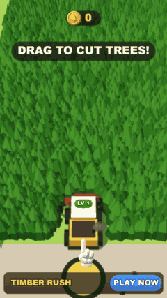
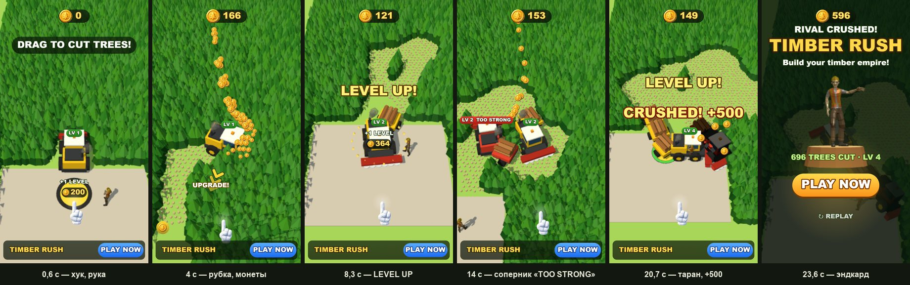

# Timber Rush 3D — playable ad на three.js, собранный ИИ-пайплайном

**▶ Играть в браузере / с телефона:** https://bankaino.github.io/timber-rush-3d-playable/
(A/B-варианты: [power_fantasy](https://bankaino.github.io/timber-rush-3d-playable/power_fantasy.html) · [short_loop](https://bankaino.github.io/timber-rush-3d-playable/short_loop.html) · [tight_timebox](https://bankaino.github.io/timber-rush-3d-playable/tight_timebox.html))

<p align="center"></p>
<p align="center"><sub>GIF ускорен ×1,5 · полное видео: <a href="docs/media/gameplay.mp4">docs/media/gameplay.mp4</a></sub></p>

Портретная playable-реклама про харвестер, который прорубает лес, апгрейдится и таранит соперника. Это **3D-версия
[Timber Rush](https://github.com/bankaino/timber-rush-playable)**: та же логика игры, но мир — настоящее 3D на three.js,
а не спрайты. Сделана по мотивам рекламного креатива лесозаготовки — со своим брендом, механикой и артом.
Инструменты: **Claude Code** (код, архитектура, скилл `ref2playable3d`), бесплатная CC0-модель персонажа
(Quaternius), процедурная геометрия в коде, ChatGPT image gen (Codex) для спрайтов HUD.



## Что внутри за 22 секунды

| время | бит | что видит игрок |
|---|---|---|
| 0–3 с | хук | рука и «DRAG TO CUT TREES!», харвестер на базе, лесоруб машет; первое дерево падает на 0,7 с |
| 3–8 с | ядро | харвестер прорубает просеку: деревья падают в сторону от ножа, щепки, монеты летят в счётчик, на вырубке остаются пни; стрелка «UPGRADE!» ведёт к площадке |
| 8,2 с | вау-момент 1 | LEVEL UP на площадке: нож шире, за машиной появляется прицеп с брёвнами |
| 8,6 с | конфликт | «RIVAL INVADES!» — красный харвестер с табличкой «LV 2 TOO STRONG»; таран отбрасывает назад |
| 19,8 с | вау-момент 2 | второй апгрейд: над соперником «CRUSH IT!», стрелка ведёт к нему |
| 20,5 с | развязка | таран: «CRUSHED! +500», обломки, тряска камеры, дождь монет |
| 22,1 с+ | эндкард | мир затемняется, 3D-лесоруб машет на пне, статистика, PLAY NOW (весь экран — CTA), REPLAY |

Принципы плейаблов те же, что в 2D-версии: хук ≤ 3 с одним пальцем, первая награда ≤ 8 с, **кнопка стора видна всё
время**, у каждой цели есть стрелка, а цена написана прямо на площадке. Рука возвращается после 2,5 с бездействия.
Эндкард показывается всем: без касаний — на 12 с, при бездействии после игры — через 10 с, жёсткий потолок — 28 с.

## Билды под рекламные сети — одной командой

```bash
python tools/build_playable.py --variant all
```

Каждый билд — **один HTML-файл** без внешних запросов: three.js, код игры, 3D-модель (GLB в base64), спрайты HUD
(WebP) и адаптер сети.

| сеть | размер | лимит | CTA / жизненный цикл |
|---|---|---|---|
| AppLovin | 1.02 MB | 5 MB | MRAID `mraid.open` |
| Unity Ads | 1.02 MB | 5 MB | MRAID |
| ironSource | 1.02 MB | 5 MB | DAPI `openStoreUrl` |
| Mintegral | 1.02 MB | 5 MB | `install()`, `gameReady()`, `gameEnd()` |
| Google Ads | 0.36 MB (zip) | 5 MB | `ExitApi.exit()` |
| Meta | 1.02 MB | 2 MB | `FbPlayableAd.onCTAClick()` |

Звук выключается, когда реклама не видна (MRAID `viewableChange` / DAPI `audioVolumeChange`). Отчёт: [docs/build-report.md](docs/build-report.md).

## Размер и производительность

| что | было | стало | как |
|---|---|---|---|
| вес билда | 1.42 MB (Luna-пакет Unity-прототипа gate3d) | **1.02 MB** | three.js урезан под игру (681 KB из 830 KB), всё inline |
| персонаж | 1.34 MB, 24 клипа, 13 draw calls | **207 KB**, 4 клипа, 1 draw call | `model.mjs`: только нужные клипы, одна палитра-материал, части тела в один меш, meshopt |
| мир (харвестеры, лес, площадка) | — | **0 байт ассетов** | процедурная low-poly геометрия в `live/scene.js` |
| код игры | — | **35 KB** | esbuild minify |
| звук | — | **0 байт** | процедурный WebAudio (`live/audio.js`) |
| draw calls на кадр (с тенями) | 100–155 | **48–72** | машина = 1 меш, колёса и пилы всех машин — 2 инстанс-пула, лес — чанки 4,8 м |
| треугольники на кадр (с тенями) | 400–480 тыс. | **210–320 тыс.** | дальние чанки леса — упрощённая ель в 5 треугольников, пни — растущий instanced-список |
| герой на экране | 35–40 % высоты | **18–24 %** | камера дальше и чуть положе (≈53°) |
| FPS на вьюпорте 390×844 | — | **61** | headless smoke-тест на GPU компьютера; на реальном телефоне ещё не мерили |

9 216 елей рисуются инстансингом по чанкам, срубленные прячутся, на их месте появляются пни. Всё, что на экране, —
чистая функция от состояния симуляции и времени, поэтому любой кадр демо можно отрендерить заново (так сделаны GIF и кадры выше).

## A/B-гипотезы

Вариант = JSON с гипотезой и переопределением параметров (`variants/*.json`), билдится той же командой. Тайминги — из
детерминированного демо-прогона:

| вариант | что меняется | таран | эндкард | гипотеза → метрика |
|---|---|---|---|---|
| `default` | контроль | 20,5 с | 22,1 с | — |
| `power_fantasy` | нож шире, харвестер быстрее (`CUT_W`, `SPD`) | 14,5 с | 16,1 с | сочная рубка важнее темпа прогресса → время в игре, CTR |
| `short_loop` | соперник LV 1 появляется на 5 с (`RIVAL_LV`, `RIVAL_AT`) | 11,6 с | 13,2 с | короче путь до вау-момента → CTR |
| `tight_timebox` | потолок 25 с, апгрейды дешевле (`END_MAX`, `PAD_COST`) | 15,1 с | 16,0 с | насколько кликов даёт сам эндкард → CTR, completion |

## Как проверяется качество

- **Демо-прогон** (`live/sim.js`, headless): `SIM.demoCheck` проверяет, что в 30-секундной петле есть уровень 3,
  соперник, таран и эндкард вовремя, а «зритель без касаний» доходит до эндкарда (12 с).
- **Зонд сцены** (`tools/probe.mjs`): рендерит 7 QA-состояний (старт, рубка, площадка, соперник, таран, эндкард,
  худший счётчик денег) и печатает **цифры вместо скриншотов**: draw calls, треугольники, сколько процентов высоты
  экрана занимает герой и виден ли он целиком, вылезает ли HUD за экран и перекрываются ли плашки.
- **Smoke-тест** (`tools/smoke_test.mjs`): открывает собранный HTML в мобильном вьюпорте с заглушкой MRAID, ведёт
  пальцем несколько секунд, жмёт CTA. Проверяет: нет ошибок, нет внешних запросов, монеты начисляются, CTA вызывает
  `mraid.open`, FPS ≥ 50.
- Всё это — одна команда `verify.sh` из скилла (около 12 строк вывода), поэтому проверка дешёвая и для агента.

## ИИ-пайплайн

1. **Выбор технологии.** Сравнили Unity + Luna (прототип gate3d работает, но редактор в цикле, сборка идёт минутами,
   много подводных камней) и three.js + Claude Code. Для быстрых гипотез выбран three.js: итерация — это перезагрузка страницы.
2. **Скилл `ref2playable3d` для Claude Code** (приватный, в разработке): рабочий 3D-шаблон, общие 3D/HUD-утилиты
   (`live/kit.js`), сборка под сети, зонд сцены, smoke-тест, оптимизатор моделей и поиск CC0-моделей.
3. **Модели.** Мир — процедурно в коде. Персонаж — бесплатная CC0-модель со скелетом, ужатая `model.mjs`. Для уникальных
   объектов в пайплайне есть локальная генерация 3D (TRELLIS.2 в ComfyUI → Blender → `model.mjs`).
4. **Логика** — детерминированная симуляция из 2D-версии без изменений: 3D-сцена только рисует её состояние.
   2D-камера симуляции (точка + зум) становится наклонной камерой слежения.

## Ограничения и следующие шаги

- На реальном Android/iPhone билд ещё не гоняли; 61 FPS — это GPU компьютера.
- Визуал на уровне шаблона: процедурные блоки, без своего логотипа. Агенты-критики по визуалу в этой итерации не запускались.
- При переключении дальних чанков леса на упрощённую ель возможны заметные «щелчки» — не проверено в движении на устройстве.
- Рука и монета в HUD взяты из 2D-версии.
- Ссылки на стор в демо ведут на этот репозиторий — для реального теста подставьте `market://` / App Store в `tools/build.json`.

## Запуск локально

```bash
python -m http.server 8000      # из корня репозитория
# http://localhost:8000/live/index.html?ad=1  — живая версия (рекламный режим), &dev — draws / треугольники / fps
# http://localhost:8000/live/index.html       — авто-демо, любое касание — играть
python tools/build_playable.py --variant all --pages docs   # билды + демо для GitHub Pages
node tools/smoke_test.mjs dist/default/applovin.html        # нужен Playwright (PLAYWRIGHT=путь к пакету)
node tools/probe.mjs                                        # цифры по QA-состояниям
```

Без установленного скилла сборка тоже работает, но кладёт three.js целиком (0,83 МБ) и не минифицирует код.

## Структура

```
live/       index.html (порядок модулей), kit.js (общие 3D/HUD-утилиты), sim.js (правила), scene.js (3D-мир),
            hud.js (интерфейс), audio.js, vendor/three.min.js, models/worker.glb, assets/ (спрайты HUD)
tools/      build_playable.py, build.json (стор, картинки, модели), smoke_test.mjs, probe.mjs
variants/   A/B-гипотезы
docs/       демо для GitHub Pages, медиа, отчёт по билду
study/      PLAN.md — решения и ход работ
art/        style_bible.txt
```

Авторство ассетов: [CREDITS.md](CREDITS.md).
